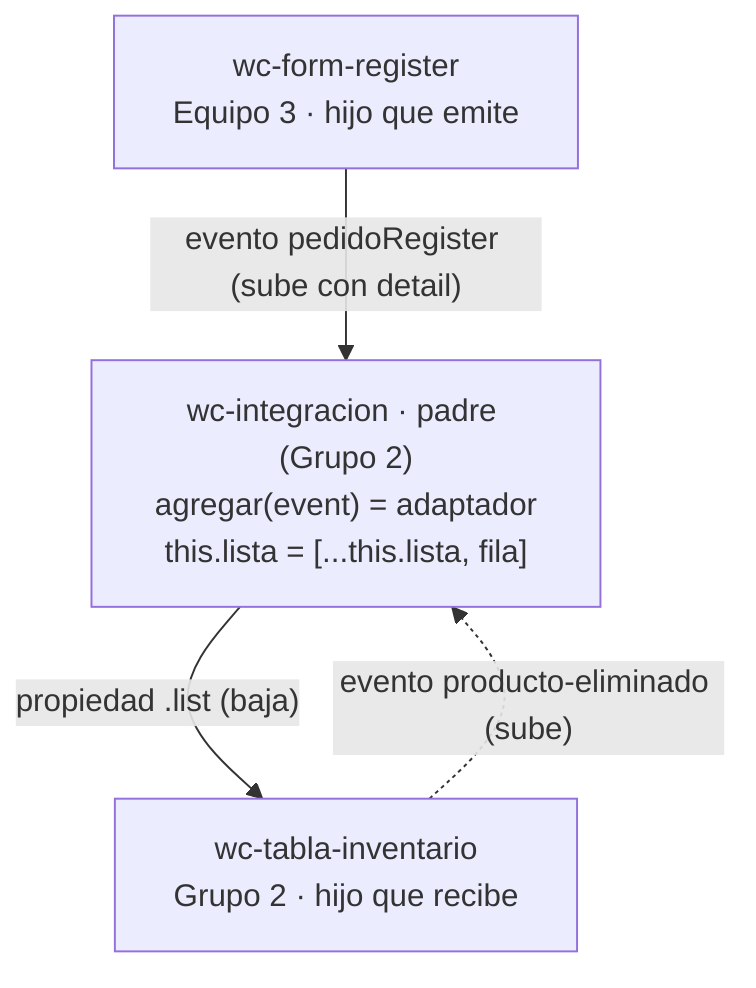

# Taller de integración · Grupo 2 · Inventario

## 1. Datos

| Dato | Valor |
|---|---|
| **Nuestro equipo** | Grupo 2 · Inventario |
| **Nuestro repositorio** | https://github.com/DaniAleG/app-lit (rama `taller-integracion`) |
| **Equipo externo** | Equipo 3 · Gestión de pedidos |
| **Repositorio externo** | https://github.com/DiegoPintoSEGO/app-lit-grupo3 |
| **Archivo externo** | `src/views/home/register.js` |
| **Commit usado** | [`84bab34`](https://github.com/DiegoPintoSEGO/app-lit-grupo3/blob/84bab34/src/views/home/register.js) |
| **Copiado sin cambios en** | `src/externos/equipo-3/register.js` |
| **Página de prueba** | `integracion.html` → http://localhost:5173/integracion.html |

**Tipo de integración:** formulario del otro equipo (`<wc-form-register>`) + tabla propia (`<wc-tabla-inventario>`).

## 2. Componentes y roles

| Componente | Archivo | Origen | Rol en la integración |
|---|---|---|---|
| `<wc-integracion>` | `src/views/integracion/integracion.js` | Grupo 2 (nuestro) | **Padre**: escucha el evento, adapta los datos y guarda la lista |
| `<wc-form-register>` | `src/externos/equipo-3/register.js` | Equipo 3 (externo) | **Hijo que emite**: dispara `pedidoRegister` con el pedido en `detail` |
| `<wc-tabla-inventario>` | `src/views/inventario/tabla-inventario.js` | Grupo 2 (nuestro) | **Hijo que recibe**: muestra la propiedad `.list`; emite `producto-eliminado` al borrar |

## 3. Flujo de comunicación

Los datos **bajan** del padre a los hijos por **propiedades** y los avisos **suben** de los hijos al padre por **eventos**.



**Paso a paso:**

1. El usuario llena el formulario del Equipo 3 y pulsa *Registrar pedido*.
2. `<wc-form-register>` emite `pedidoRegister` con `bubbles: true, composed: true`, así el evento sale de su Shadow DOM.
3. `<wc-integracion>` lo escucha con `@pedidoRegister=${this.agregar}` y lee `event.detail`.
4. El método `agregar(event)` **adapta** el pedido al formato de nuestra tabla y crea un **arreglo nuevo** con `this.lista = [...this.lista, fila]` (no se usa `push`, porque Lit solo re-renderiza si cambia la referencia).
5. La lista **baja** a la tabla con `.list=${this.lista}` y aparece la fila nueva.
6. Si se pulsa *Eliminar*, la tabla emite `producto-eliminado` con `{ codigo }` y el padre filtra la lista.

### El adaptador

Los dos componentes no usan el mismo formato, así que el padre convierte los datos. **El componente externo no se modifica.**

| Detail del Equipo 3 (`pedidoRegister`) | → | Fila de nuestra tabla (`.list`) |
|---|:---:|---|
| *(no existe)* | → | `codigo`: generado `PED-001`, `PED-002`… con un contador |
| `producto` | → | `nombre` (si llega vacío: "Sin producto") |
| `cliente` | → | `categoria`: "Pedido de *cliente*" |
| `cantidad` | → | `cantidad` (con `Number()`; si es texto → `0`) |
| `precio` | → | `precio` (con `Number()`; si es texto → `0`) |
| `fecha`, `estado` | → | no se usan (la tabla no tiene esas columnas) |

```js
agregar(event) {
  const pedido = event.detail ?? {};
  const fila = {
    codigo: `PED-${String(++this.contador).padStart(3, "0")}`,
    nombre: pedido.producto || "Sin producto",
    categoria: `Pedido de ${pedido.cliente || "cliente sin nombre"}`,
    cantidad: this.aNumero(pedido.cantidad),
    precio: this.aNumero(pedido.precio),
  };
  this.lista = [...this.lista, fila];
}
```

## 5. Evaluación del componente externo

**Componente evaluado:** `<wc-form-register>` (formulario de Gestión de pedidos) · Equipo 3
**Repositorio:** https://github.com/DiegoPintoSEGO/app-lit-grupo3 · archivo `src/views/home/register.js` · commit [`84bab34`](https://github.com/DiegoPintoSEGO/app-lit-grupo3/blob/84bab34/src/views/home/register.js)
**Archivo copiado sin cambios en:** `src/externos/equipo-3/register.js`
**Evaluado por:** Rol 3 · Revisión externa
**Issue abierto en su repo:** https://github.com/DiegoPintoSEGO/app-lit-grupo3/issues/1

| Criterio | Nota (0–5) | Evidencia |
|---|:---:|---|
| **API clara** | 4 | El JSDoc de las líneas 3–15 documenta el evento, cada campo del `detail` con su tipo y los valores posibles de `estado`, y su README repite la API con un ejemplo de uso. Baja un punto porque el README sigue con el título de plantilla "Equipo N" y no indica qué número de equipo es ni qué commit usar. |
| **Evento** | 4 | Emite `pedidoRegister` con `bubbles: true, composed: true` (líneas 151–156), así que atraviesa el Shadow DOM y lo escuchamos desde `<wc-integracion>`. `cantidad` y `precio` llegan como `Number` (líneas 146–147). Baja un punto porque el nombre está en camelCase; la convención es kebab-case (`pedido-registrado`). |
| **Robustez** | 3 | La validación depende solo de `required`, `min` y `type="number"` del HTML (líneas 179–201). Probado: si se escriben solo espacios en *Cliente* y *Producto*, el formulario se envía con `cliente: ""` y `producto: ""` (líneas 144–145). No hay validación en JavaScript antes del `dispatchEvent`. Reportado en el [issue #1](https://github.com/DiegoPintoSEGO/app-lit-grupo3/issues/1). |
| **Encapsulamiento** | 5 | Todos los estilos están en `static styles` (líneas 18–108) con `:host`; no afectan a nuestra página ni la página los afecta. |
| **Reutilización** | 4 | Solo importa `lit` (línea 1): lo copiamos sin cambiar ni una línea y funcionó a la primera. Baja un punto porque el nombre `wc-form-register` (línea 233) es genérico y podría chocar con el de otro equipo. Sugerimos `wc-form-pedido`. |
| **Total** | **20 / 25** | |

**Pruebas realizadas** (en `http://localhost:5173/integracion.html`):

1. Pedido válido → aparece una fila nueva en `<wc-tabla-inventario>`. ✅
2. Campos vacíos → el navegador bloquea el envío. ✅
3. Solo espacios en *Cliente* y *Producto* → se envía el pedido vacío; en la consola llega `cliente: ''` y `producto: ''`, y en la tabla aparece "Sin producto". ❌ (reportado en el issue #1)
4. Cantidad `0` o negativa → el navegador bloquea el envío. ✅
