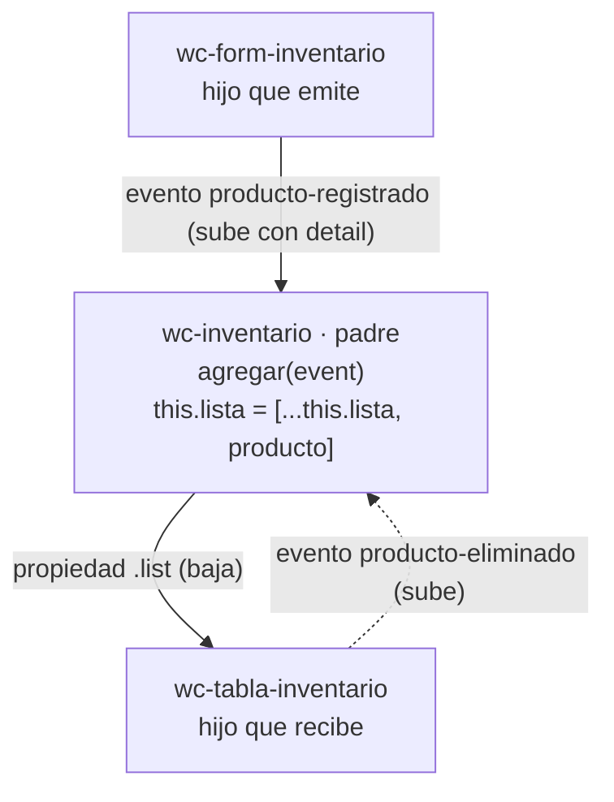

# Flujo de comunicación · Inventario (Grupo 2)

Los datos **bajan** del padre a los hijos por **propiedades** y los avisos **suben** de los hijos al padre por **eventos**.

## Diagrama



## Componentes

| Componente | Archivo | Rol | Recibe | Emite |
|---|---|---|---|---|
| `<wc-inventario>` | `inventario.js` | Padre | — | — (escucha a los hijos) |
| `<wc-form-inventario>` | `form-inventario.js` | Hijo que emite | nada | `producto-registrado` |
| `<wc-tabla-inventario>` | `tabla-inventario.js` | Hijo que recibe | `.list` | `producto-eliminado` |

## Paso a paso

1. El usuario llena el formulario y pulsa **Registrar**.
2. `<wc-form-inventario>` valida los campos y emite `producto-registrado` con `bubbles: true, composed: true`:
```js
   detail: { codigo, nombre, categoria, cantidad, precio }
```
3. `<wc-inventario>` lo escucha con `@producto-registrado=${this.agregar}` y lee `event.detail`.
4. Si el código ya existe, suma la cantidad; si no, lo agrega. Siempre crea un **arreglo nuevo**:
```js
   this.lista = [...this.lista, producto];
```
   No se usa `push`: Lit solo vuelve a renderizar si cambia la referencia del arreglo.
5. La lista **baja** a la tabla con `.list=${this.lista}` y aparece la fila nueva.
6. Al pulsar **Eliminar**, la tabla emite `producto-eliminado` con `{ codigo }` y el padre hace `this.lista = this.lista.filter(...)`.

## Pruebas realizadas

| Prueba | Resultado esperado |
|---|---|
| Abrir la página sin datos | La tabla muestra "No hay productos registrados" |
| Registrar un producto válido | Aparece una fila nueva en la tabla |
| Dejar un campo vacío | Mensaje "Todos los campos son obligatorios." y no se emite el evento |
| Escribir texto o un negativo en cantidad/precio | Mensaje de error y no se emite el evento |
| Registrar cantidad menor que 5 | La fila muestra "Stock bajo" |
| Consola del navegador | Sin errores |
